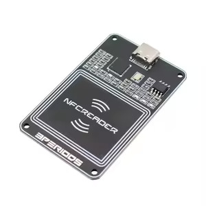

# PN532 NDEF Emulator

Standalone Python NFC tag emulator for plain PN532 boards. Serves any NDEF
message, a URL, text, a MIME file, or raw bytes, and broadcasts until you
stop it. Verified on iPhone and Android.



**Hardware tested:** PCR532 USB-C (Got it from Taobao)

## Install

Requires Python 3.9+ and [pyserial](requirements.txt).

```bash
python3 -m venv .venv
.venv/bin/pip install -e .
```

## Usage

```bash
python3 emulator.py --url https://example.com
python3 emulator.py --text "Hello world"
python3 emulator.py --mime image/png picture.png
python3 emulator.py --ndef-hex D1010B5504...
python3 emulator.py --ndef-file message.bin

# Multiple records, any mix, flags repeatable
python3 emulator.py --url https://example.com --text "Scan me"

# Explicit port (or set PN532_PORT)
python3 emulator.py --url https://example.com --port /dev/ttyUSB0

# Advertise as writable
python3 emulator.py --url https://example.com --cc-writable
```

Notes.
- Phones act on the first record only, so order flags by what you want shown.
- The CC advertises the message size, 1024 bytes minimum, 65535 maximum.
  Large messages read slowly in ~84-byte chunks.
- URL records are phone-verified. Text is wire-verified but not tap-verified.
  MIME display depends on the phone's stack.

## Troubleshooting

- **No phone reaction:** check NFC and screen, then look for `RF field
  present` in the trace. Silence means the phone never scanned.
- **`no firmware response`:** wrong port, or held by another process
  (`lsof /dev/cu.usbserial-110`).
- **One tap works, the next does not:** old version without the re-arm guard.

## License

MIT License. Copyright (c) 2016 Manuel Fernando Galindo, (c) 2026 LikKee

Permission is hereby granted, free of charge, to any person obtaining a copy
of this software and associated documentation files (the "Software"), to deal
in the Software without restriction, including without limitation the rights
to use, copy, modify, merge, publish, distribute, sublicense, and/or sell
copies of the Software, and to permit persons to whom the Software is
furnished to do so, subject to the following conditions:

The above copyright notice and this permission notice shall be included in all
copies or substantial portions of the Software.

THE SOFTWARE IS PROVIDED "AS IS", WITHOUT WARRANTY OF ANY KIND, EXPRESS OR
IMPLIED, INCLUDING BUT NOT LIMITED TO THE WARRANTIES OF MERCHANTABILITY,
FITNESS FOR A PARTICULAR PURPOSE AND NONINFRINGEMENT. IN NO EVENT SHALL THE
AUTHORS OR COPYRIGHT HOLDERS BE LIABLE FOR ANY CLAIM, DAMAGES OR OTHER
LIABILITY, WHETHER IN AN ACTION OF CONTRACT, TORT OR OTHERWISE, ARISING FROM,
OUT OF OR IN CONNECTION WITH THE SOFTWARE OR THE USE OR OTHER DEALINGS IN THE
SOFTWARE.
